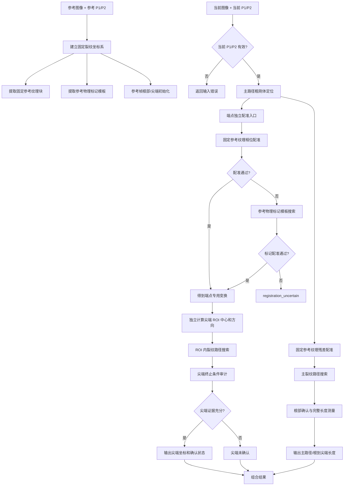
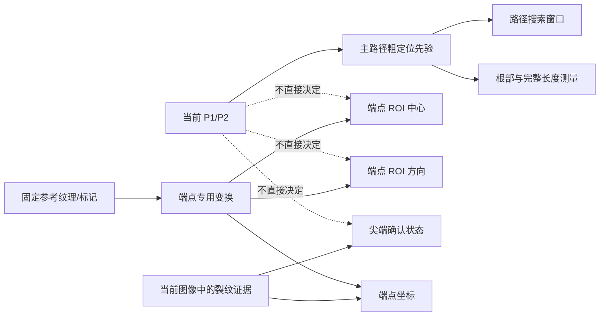
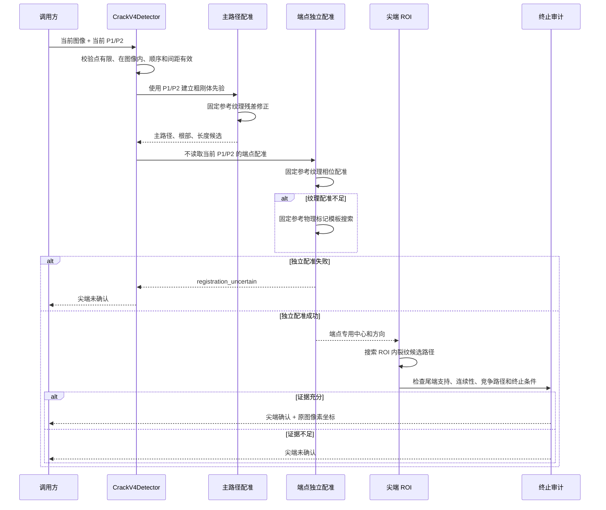
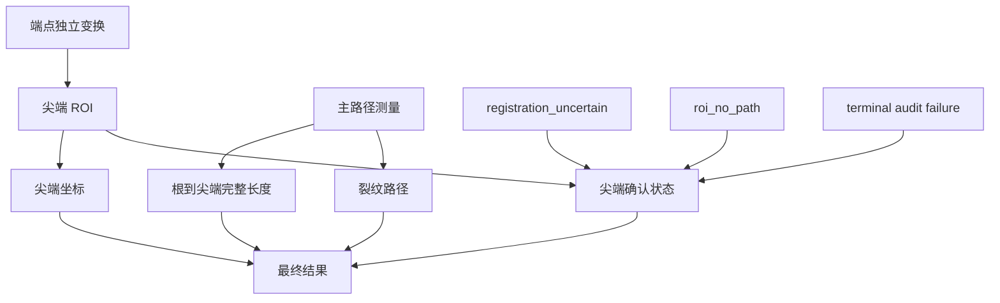

# 当前基准点解耦算法

## 总体流程

## 当前 P1/P2 的作用边界

## 单帧处理顺序

## 输出关系

## 解耦验证判据

固定参考图像、当前图像和算法参数，只改变当前帧 P1/P2：

1. 尖端确认状态必须一致；
2. 已确认尖端的 `(x, y)` 必须一致；
3. 完整路径和长度单独评估，因为它们仍允许使用 P1/P2 作为主路径粗定位先验；
4. 越界、反向、退化或错误物理对应的 P1/P2 属于输入有效性问题，不作为正常解耦样本。

当前候选版本的严格验证记录见：

[anchor_decoupling_strict_20261110_r03/REPORT.md](../output/runs/anchor_decoupling_strict_20261110_r03/REPORT.md)
