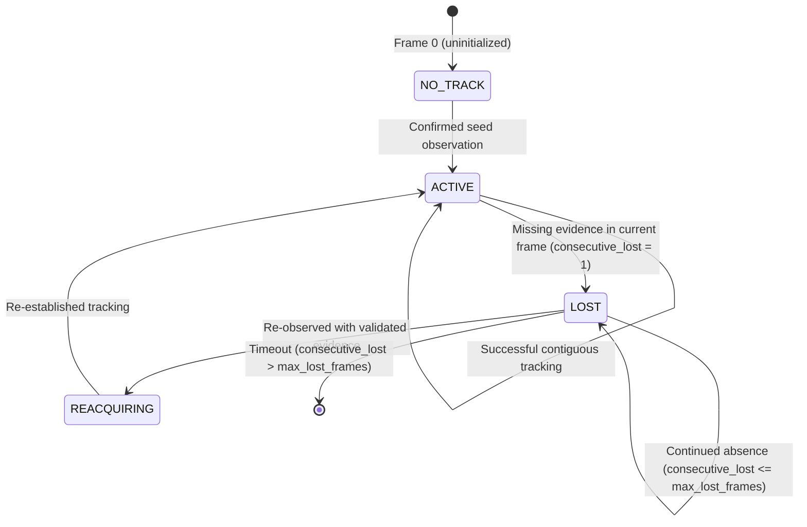

# State Machine & Lifecycle Specification (`UCTIP-60Q-v1.0`)

## 1. Track Branch Lifecycle

## 2. Invariant Rules
1. **Separation of Observed vs Historical Extent**:
   - `current_observed_tip`: Represents actual dark line pixels observed in the current frame.
   - `historical_reliable_extent`: Maximum historical coordinate used for scouting and ROI expansion. It is NEVER substituted as the current frame's tip when crack is closed or obscured.
2. **Absence of Single-Frame Displacement Hard Gate**:
   - Resolutions 55 and 56 formally supersede Resolution 46.
   - Sudden jumps trigger `MOTION_ANOMALY_RECHECK`. If verified by RAW valley depth or dual reference difference, the jump is accepted.
3. **Multi-Branch Tip Selection**:
   - Multiple branches are concurrently tracked.
   - The official output is selected as $\text{argmax}(\text{image\_x})$ among all verified branches, even if the winning branch is not the historical primary stem.
