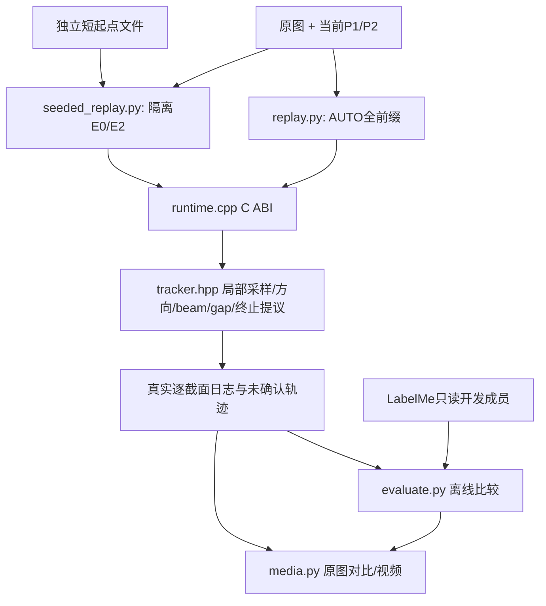

# 源码依赖与证据责任

生产src/cpp/a/CrackV4.cpp与roi_tip.inc：旧参考门/局部DP/最终确认；本轮未改。R05F research/uctt_r05f/current.hpp：静态窗口暗谷、4列短分量门；仅通过原研究runtime做80选帧重放。历史发布DLL1c742与研究55a0分别冻结，A0_frames.jsonl仅来自55a0。

新tracker.hpp::crossSection只读当前灰度；originSeeds做有界近起源搜索；track做真实前后依赖扩展；fittedDirection只用visible节点；terminalAudit只给局部停止与几何建议，无独立身份认证。runtime.cpp永不把建议写observed。reference图只用于初始化尺寸。

native.py是无标签ctypes桥；replay.py没有种子或LabelMe入口；seeded_replay.py只读独立短种子；evaluate.py/weak_audit.py/origin_audit.py/profile_plots.py/media.py负责离线证据。原图读取先执行dataset_policy。所有编译、日志、图片与视频均在output/。
