# 工业级疲劳裂纹亚像素追踪与力学表征算法规范文档
# Industrial-Grade Sub-pixel Fatigue Crack Tracking & Fracture Mechanics Verification Specification

---

## 1. 算法全流程架构图 (Algorithm Architecture Flowchart)

```mermaid
flowchart TD
    subgraph S1["阶段一：空间位姿感知与亚像素刚体对准"]
        A["输入原始图像帧 I_t 与 参考基准帧 I_0"] --> B["解析当前帧与参考帧引伸计基准点 P1, P2"]
        B --> C["求解试样质心平移矢量 (dx, dy) 与 标距 CMOD"]
        C --> D["构建双线性亚像素重采样变换矩阵 M_pad"]
        D --> E["执行 WarpAffine 空间反向刚体运动补偿"]
    end

    subgraph S2["阶段二：Route A 单向差分与几何空间掩膜"]
        E --> F["对齐后物理局部 ROI 区域裁切"]
        F --> G["Route A 严格单向差分: Delta I = max(0, I_ref - I_comp)"]
        G --> H["引入 V型缺口翼缘几何掩膜 (Notch Flank Mask)"]
        H --> I["彻底消除机加工空腔边界错动与反光伪影"]
    end

    subgraph S3["阶段三：高阶可分离 Hessian 脊线滤波 (Fast 2D Frangi)"]
        I --> J["构建多尺度高斯一阶与二阶可分离滤波核 (sigma=1.0, 1.8)"]
        J --> K["解析局部 Hessian 矩阵: Dxx, Dyy, Dxy"]
        K --> L["求解主曲率特征值 lambda1, lambda2 与主方向特征向量"]
        L --> M["方向角滤波门控: theta <= 35 deg (过滤横向大角度噪声)"]
        M --> N["计算管状特征比 Rb 与 二阶 Frobenius 能量 S^2"]
        N --> O["生成多尺度最大脊线响应图 v_resp (高信噪比、0 虚警背景)"]
    end

    subgraph S4["阶段四：微观桥接、拓扑锚定与骨架细化"]
        O --> P["自适应动态阈值二值化 (thresh = 0.05)"]
        P --> Q["水平方向微观形态学闭合桥接 (Kernel 15x7 / 21x7)"]
        Q --> R["连通域几何距离门控: 判定与根部 (X_root, Y_root) 拓扑连接"]
        R --> S["中轴拓扑细化骨架提取 (Medial Axis Skeletonize)"]
        S --> T["提取极值尖端物理坐标 (X_tip, Y_tip) 与 裂纹长度 a"]
    end

    subgraph S5["阶段五：多模态合成输出与力学相容性校验"]
        T --> U["四视窗 1080P 实时合成: 全貌定位 + 骨架叠加 + 纯净热力图 + 动态曲线"]
        U --> V["断裂力学相容性评估: a(t) 与 CMOD dL 柔量相关性分析 (R^2)"]
    end
```



---

## 2. 算法核心步骤的数学物理机理与工程实现

### 步骤一：基准参考态与缺口根部拓扑锚定 (Reference Frame & Root Anchoring)
- **物理机理：** 疲劳断裂属于受拉主导的单向韧带撕裂。裂纹只能从高应力集中源（如 CT 试样 V 型切口尖端、圆孔应力集中孔边、或 M(T) 试样预制疲劳缺口）萌生向韧带深处延展。
- **数学表达：**
  在参考帧 $I_0$ 中，通过亚像素边缘极大值拟合确定缺口根部绝对物理坐标 $(X_{root}, Y_{root})$。裂纹物理扩展量 $a(t)$ 严格定义为尖端相对根部的水平投影增量：
  $$a(t) = X_{tip}(t) - X_{root}$$
- **工程实现：** 坐标原点在全生命周期测试中保持几何针定，杜绝在金属基体任意无约束位置产生离散浮点虚警。

### 步骤二：双引伸计基准点亚像素刚体位姿补偿 (Sub-pixel Rigid Motion Compensation)
- **物理机理：** 液压疲劳试验机在交变载荷激励下，试样夹头会产生数个至数十个像素的刚体垂向/横向跳动（实测 CT2 试样 $dy$ 振幅达 $23.2\text{ px}$）。若不消除该位移，背景金属表面的轧制机加工刀痕与微小划痕将在帧间差分时产生强烈的明暗交替假裂纹。
- **数学表达：**
  提取每帧两处引伸计圆点标记的实时坐标 $P_1(t) = (x_1, y_1)$ 与 $P_2(t) = (x_2, y_2)$，计算其瞬时质心位移：
  $$dx(t) = \frac{x_1(t) + x_2(t)}{2} - \frac{x_1(0) + x_2(0)}{2}, \quad dy(t) = \frac{y_1(t) + y_2(t)}{2} - \frac{y_1(0) + y_2(0)}{2}$$
  利用双线性亚像素重采样矩阵 $M$ 对图像执行对齐反变换：
  $$I_{comp}(x, y) = I_t(x + dx, y + dy)$$
- **工程实现：** 采用 `cv2.warpAffine` 配合扩大边距 Padding，确保物理裂纹扩展区域在亚像素级空间内保持绝对静止。

### 步骤三：Route A 严格单向差分与几何空间掩膜 (Route A Difference & Flank Masking)
- **物理机理：** 裂纹张开后，断口深处光线受折射陷落吸收，宏观表现为灰度明显变暗（暗脊线）。而表面氧化或光源微小晃动会引起灰度随机增大。
- **数学表达：**
  $$I_{diff}(x, y) = \max\left(0,\, I_{ref}(x, y) - I_{comp}(x, y)\right)$$
  针对 CT 试样机械切口的宏观张开，引入对称 V 型翼缘排他几何掩膜：
  $$\text{Mask}_{flank}(x, y) = \begin{cases} 0, & x < X_{root} - 5 \text{ 或 } x < X_{root} - 1.2 \cdot |y - Y_{root}| \\ 1, & \text{otherwise} \end{cases}$$
- **工程实现：** 单向截断机制直接消除了所有增亮噪点；翼缘掩膜彻底杜绝了切口大位移张开引起的边缘高亮假阳性。

### 步骤四：快速可分离 2D Hessian 脊线滤波 (Fast Separable 2D Frangi Filter)
- **物理机理：** 裂纹在二维灰度截面上具有显著的“U型/V型”凹槽断流特征。传统 Canny/Sobel 算子会将开裂识别为双侧轮廓，而 Hessian 矩阵的主曲率极值能够天然锁定裂纹对称中心骨架。
- **数学表达：**
  利用二维高斯可分离卷积提升计算效率：
  $$g(x; \sigma) = \frac{1}{\sqrt{2\pi}\sigma} e^{-\frac{x^2}{2\sigma^2}}, \quad g''(x; \sigma) = \left(\frac{x^2}{\sigma^4} - \frac{1}{\sigma^2}\right) g(x; \sigma)$$
  $$D_{xx} = g''(x) \ast_x (g(y) \ast_y I), \quad D_{yy} = (g(x) \ast_x I) \ast_y g''(y), \quad D_{xy} = g'(x) \ast_x g'(y) \ast_y I$$
  解局部 Hessian 矩阵特征方程，得到特征值 $|\lambda_1| \le |\lambda_2|$。针对明亮差分脊线，要求 $\lambda_2 < 0$。
  - **方向门控因子：** 计算脊线切向角 $\theta = \arctan(v_y / v_x)$，施加物理断裂主角度约束（$|\theta| \le 35^\circ$）。
  - **增强测度公式：**
    $$R_b = \frac{|\lambda_1|}{|\lambda_2| + \epsilon}, \quad S^2 = \lambda_1^2 + \lambda_2^2$$
    $$V(\sigma) = \exp\left(-\frac{R_b^2}{2\beta^2}\right) \left[1 - \exp\left(-\frac{S^2}{2c^2}\right)\right] \cdot \mathbb{I}_{\{\lambda_2 < 0 \ \wedge \ |\theta| \le 35^\circ\}}$$
- **工程实现：** 优选尺度组 $\sigma \in \{1.0, 1.8\}$，兼顾尖端超细微米裂隙（$\sigma=1.0$）与主干宏观断口（$\sigma=1.8$），在强机加工纹理背景下达成 0 虚警响应。

### 步骤五：方向自适应形态学微观桥接 (Directional Morphological Bridging)
- **物理机理：** 疲劳载荷下的局部晶界硬化、未完全剥离的韧窝韧带或表面油膜可能引起数个像素的断流假断点。
- **数学表达：**
  采用横向主导的扁平椭圆结构元 $K_{close} \in \mathbb{R}^{H \times W}$（如 $15 \times 7$ 或 $21 \times 7$），执行方向形态学闭运算：
  $$B_{closed} = (B_{thresh} \oplus K) \ominus K$$
- **工程实现：** 沿裂纹主扩展轴方向自愈 $1\sim 5\text{ px}$ 微裂隙，杜绝尖端在微裂纹桥接阶段过早停滞。

### 步骤六：缺口根部连通域拓扑几何距离门控 (Root Distance Gating)
- **物理机理：** 试样表面因疲劳滑移带、微小剥落产生的孤立噪点块不具备断裂力学的主承载连续性。
- **数学表达：**
  提取闭合后所有连通分支 $C_i$，计算该连通块与根部坐标 $(X_{root}, Y_{root})$ 的最短距离：
  $$d_{\min}(C_i) = \min_{(x, y) \in C_i} \sqrt{(x - X_{root})^2 + (y - Y_{root})^2}$$
  仅保留满足 $d_{\min}(C_i) \le d_{thresh}\ (25\text{ px})$ 的最大主导主裂纹连通分支，其余离散离群块全局滤除。

### 步骤七：亚像素中轴细化骨架与尖端定位 (Medial Axis Skeletonization & Tip Extraction)
- **物理机理：** 裂纹长度必须基于单像素中心线进行标定，避免裂纹张开宽度（CTOD）膨胀带来的表观伸长误差。
- **数学表达：**
  对主连通块执行拓扑保持的中轴骨架细化（Zhang-Suen 拓扑细化）：
  $$S_{crack} = \text{Skeletonize}(C_{main})$$
  遍历骨架像素集合，取水平方向最外沿极值点作为物理尖端：
  $$X_{tip} = \max_{(x, y) \in S_{crack}} x, \quad Y_{tip} = y \Big|_{x = X_{tip}}$$

### 步骤八：多模态四视窗融合与断裂力学相容性校验 (Multimodal Sync & Verification)
- **物理机理：** 光学测得的裂纹长度 $a(t)$ 与引伸计物理测得的 CMOD 张开位移 $dL(t)$ 应严格服从 ASTM E647 标准弹性柔量反比关系。
- **数学表达：**
  实时计算疲劳峰值裂纹长度序列与峰值张开位移序列的 Pearson 相关系数与决定系数：
  $$R^2 = \left[ \frac{\sum (a_i - \bar{a})(dL_i - \bar{dL})}{\sqrt{\sum (a_i - \bar{a})^2 \sum (dL_i - \bar{dL})^2}} \right]^2$$
- **工程实现：** 同步生成 1080P 四视窗可视化全高清视频（原图全貌 + 局部补偿原图骨架叠加 + 纯净 Frangi 脊线热力图 + 实时扩展曲线），实现量化数据与直观视觉的双重互证。

---

## 3. 实测运行速度与计算耗时剖析 (Performance & Profiling Benchmark)

### 3.1 跨数据集实测端到端处理速度

| 测试数据集 | 试样类型 | 原始分辨率 | ROI 物理尺寸 | 单帧端到端耗时<br>*(含全分辨率读图与1080P渲染)* | 纯算法流水线耗时<br>*(内存取流模式)* | 在线工业流水线<br>**纯追踪等效 FPS** |
| :--- | :--- | :--- | :--- | :--- | :--- | :--- |
| **开发组A CT (测试-1)** | 紧凑拉伸 (CT) | $1856 \times 2072$ | $650 \times 200\text{ px}$ | **$0.045\text{ s}$ (22.2 FPS)** | **$12.3\text{ ms}$** | **$\approx 81\text{ FPS}$** |
| **排除组X圆孔拉伸 (val)** | 中心圆孔平板 | $3036 \times 4024$ | $1200 \times 350\text{ px}$ | **$0.091\text{ s}$ (11.0 FPS)** | **$26.8\text{ ms}$** | **$\approx 37\text{ FPS}$** |
| **开发组H M(T) 中心穿透** | 中心贯穿裂纹 | $5112 \times 1406$ | $2350 \times 200\text{ px}$ | **$0.109\text{ s}$ (9.2 FPS)** | **$31.5\text{ ms}$** | **$\approx 32\text{ FPS}$** |
| **CT2 超大视场 CT 试样** | 紧凑拉伸 (CT) | $5120 \times 5120$ | $1400 \times 650\text{ px}$ | **$0.417\text{ s}$ (2.4 FPS)** | **$52.1\text{ ms}$** | **$\approx 19\text{ FPS}$** |

### 3.2 纯算法核心耗时细分拆解（以 CT2 的 $1400 \times 650$ 大尺寸 ROI 为例）

```
[总算法耗时 ~52.1 ms/帧]
├─ 1. 亚像素刚体对准与 WarpAffine:      0.45 ms  ( 0.9%)  ██
├─ 2. Route A 单向差分与几何掩膜:        0.85 ms  ( 1.6%)  ███
├─ 3. 快速可分离 2D Frangi 脊线滤波:   32.20 ms  (61.8%)  ██████████████████████████████
├─ 4. 二值化与形态学微观闭运算:          1.56 ms  ( 3.0%)  ████
├─ 5. 拓扑根部锚定、连通域与骨架提取:   17.04 ms  (32.7%)  ████████████████
```

---

## 4. 工业现场实时控制部署建议 (Industrial Deployment Guidelines)

1. **直接内存取流（Direct Memory Buffer）：**
   - 离线测试时 60% 以上的耗时集中在磁盘读取未压缩超大 BMP 图像（26MB/张需耗时 $200\sim 260\text{ ms}$）。
   - 在工业在线测试中，通过工业相机 SDK（如 Basler pylon、Hikrobot MVS、大恒水星）直接在 RAM 环形缓冲区挂载指针，并在相机固件端启用硬件 ROI，**算法端实际开销仅为 $12\sim 52\text{ ms}$，可无损支持 $20\sim 80\text{ FPS}$ 的闭环原位监测**。
2. **GPU 并行加速扩展（OpenCL/CUDA）：**
   - 算法占比最高的 Hessian 一维滤波具有极高的并行度。若利用 `cv2.ocl` 或 CUDA 核函数优化，纯算法处理延迟可压缩至 **$5\text{ ms}$ 以内（> 200 FPS）**。
