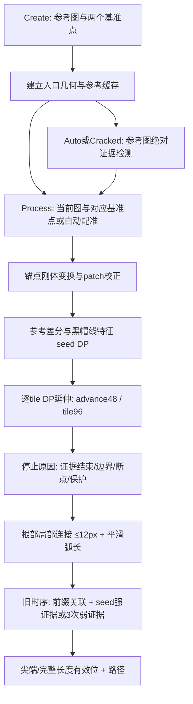

# V4 基线审查（2026-10-28）

## 可回溯基线

原算法未覆盖。快照：`D:/workspace\crack_v4_cpp\snapshots\v4_opencv440_before_reliability_20261028_174204`，归档：`D:/workspace\crack_v4_cpp\snapshots\v4_opencv440_before_reliability_20261028_174204.zip`。
66 个文件按 SHA256 校验一致；内容含原 OpenCV4.4 SDK、DLL、C++ 源码、Python 对照代码、四组逐帧记录、构建配置及本次开发文档。
原 DLL SHA256：`a122bda86870c7a41fcd8055f8da95f91ed93b80ecdbd539ac1c8341ca0cb4ea`。
如需回退，关闭使用 DLL 的程序，恢复快照 `sdk/bin/CrackV4.dll` 和配套旧 include/lib；不要把新 wrapper 与旧 DLL 混用。
新开发位于独立目录 `reliability_v5`，原始目录不是 Git 仓库；此目录另建 Git，按阶段提交。

## 构建与数据

Windows，AMD Ryzen 9 7950X，x64 Release，MSVC v142 19.29.30159，C++17，/MD /O2 /fp:precise；OpenCV **4.4.0**，路径 `D:/opencv-4.4.0`，固定 4 线程。
基线从原源码独立重编译，启用分段 profiler；与冻结的原4.4逐帧记录比较，1991 帧完全一致。未使用4.12作为本次基线。

| 试验 | 帧数 | 分辨率 | 参考模式 | 最大tile | 最大路径点数 | 最长已确认弧长px |
| --- | --- | --- | --- | --- | --- | --- |
| 开发组A测试-1 | 551 | 1856×2072 | Clean | 10 | 447 | 453.97 |
| 验证组C | 562 | 5120×5120 | Clean | 8 | 301 | 297.58 |
| CT2 | 468 | 5120×5120 | Auto已有裂纹 | 24 | 1108 | 1119.56 |
| 开发组HMT | 410 | 5112×1406 | Clean | 18 | 825 | 823.77 |

四组完整数据可读，但没有人工尖端/路径标注，也没有逐帧实测锚点文件。本次真实序列继续使用原自动配准模式；不能把结果一致解释为准确率100%。像素是唯一评估单位。

## 调用与状态

参考图缓存、previous、history、刚体变换是每实例状态。旧 history 至多4条路径，加当前帧最多5次证据；前缀一致是路径关联，原逻辑不能独立证明端点可靠。
两个锚点提供方向与平移，不把加载导致的点间距变化当成图像倍率缩放。

## 已复现工程缺陷

1. 弱裂纹第3次处理前读取基线10次，原版时序证据变成1次，控制流为3次。
2. 无纹理参考帧查询基线可能因为 patch 配准失败报错；参考自身本应使用身份变换。
3. 无效 result struct_size 的 Process 会先运行检测并推进历史，再返回错误。
4. Auto 未确认参考裂纹时，没有独立的“不确定”状态；这不能证明参考图干净。

修正后的原版6项测试中3项失败，见 `results/baseline_engineering_corrected.json`；首次测试文件曾把Image结构误写成32字节，实际x64为24字节，已修正测试。此测试错误没有计入算法缺陷。

## 基线计时（ms）

每组前10帧warm-up剔除；错误帧单列，不作为有效检测样本。基线启用profiler，会有轻微计时开销。

| 试验 | 核心P50 | P95 | P99 | max | >66.67ms |
| --- | --- | --- | --- | --- | --- |
| 开发组A测试-1 | 8.75 | 11.17 | 12.60 | 13.72 | 0 |
| 验证组C | 4.44 | 5.72 | 6.63 | 7.10 | 0 |
| CT2 | 17.21 | 22.23 | 24.07 | 26.58 | 0 |
| 开发组HMT | 40.29 | 48.26 | 53.49 | 58.19 | 0 |

开发组H平均耗时分解（包含关系不可相加）：seed约37.64ms、tile约31.82ms、seed DP约3.01ms、延伸DP约0.25ms；tile统计约11.44ms、offset约6.51ms、线特征约4.45ms。
因此优先删除无用Tile::raw与bounds工作，没有依据重写延伸DP或引入FastTrack。

配准遗留错误：CT2 27帧全部自动patch失败，开发组H5帧patch位移不一致。真实相机采集、显示、软件集成队列未测试。
